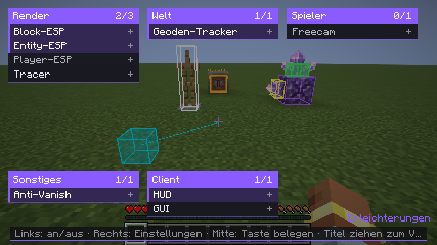
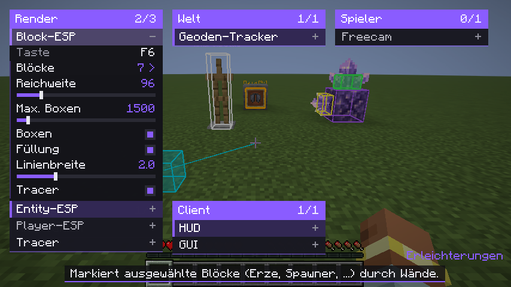
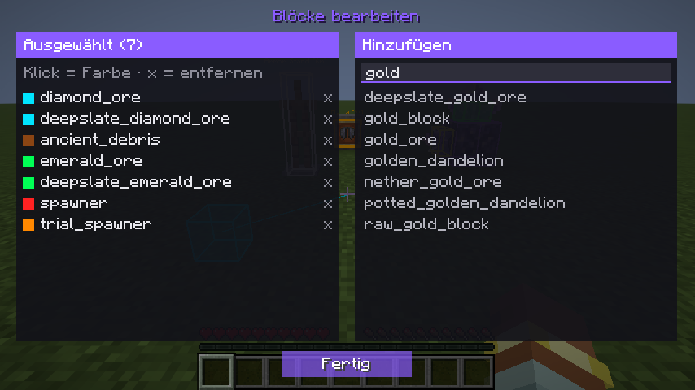
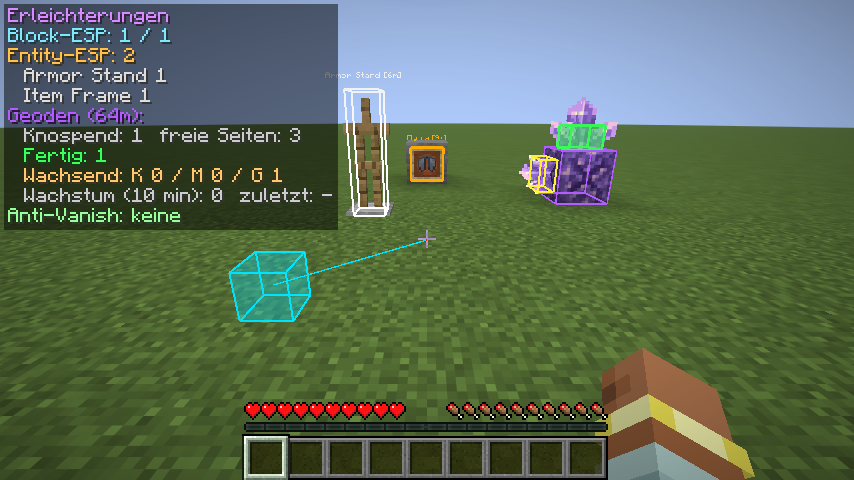
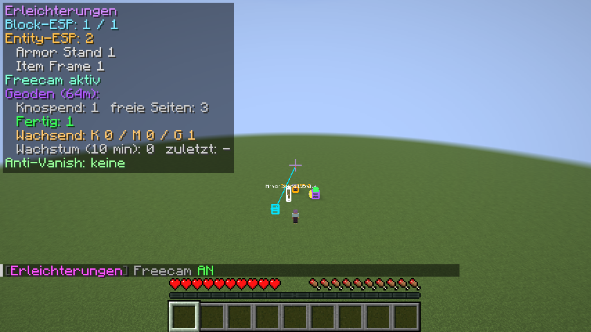

# Erleichterungen – Fabric-Client-Mod für Minecraft 26.3

Client-seitige Fabric-Mod mit sechs Modulen und einer Click-GUI (**Rechte Shift-Taste**):




| Modul | Taste | Beschreibung |
|---|---|---|
| **Block-ESP** | `F6` | Markiert ausgewählte Blöcke (Standard: Diamant-/Smaragderz, Antiker Schrott, Spawner) farbig durch Wände. |
| **Entity-ESP** | `F4` | Markiert Base-typische Entities durch Wände: Item Frames (mit Gegenstand als Text), leuchtende Item Frames, Rüstungsständer, Gemälde, Truhen-/Trichter-Loren, Truhen-Boote, Villager, Leinenknoten, Endkristalle. Typen frei erweiterbar. |
| **Player-ESP** | `F7` | Boxen + Name + Entfernung um alle Spieler, durch Wände sichtbar. Vanish-Verdächtige in Magenta. |
| **Geoden-Tracker** | `F8` | Findet knospenden Amethyst und alle Knospen, färbt sie nach Wachstumsstufe, erkennt Wachstum live und meldet ausgewachsene Cluster. |
| **Anti-Vanish** | `F9` | Erkennt Spieler, die per Vanish unsichtbar sind (standardmäßig an). |
| **Freecam** | `G` | Kamera frei bewegen, der Spieler bleibt stehen. WASD, Leertaste/Shift = hoch/runter, Sprint = schneller. |
| HUD | `F10` | Info-Overlay oben links. |
| **Einstellungs-GUI** | `Rechte Shift` | Alle Module und Einstellungen übersichtlich an einem Ort. |

Alle Tasten lassen sich unter *Optionen → Steuerung → Erleichterungen* ändern.

## Installation

**Direkter Download (ohne GitHub-Login):**
https://github.com/paulpuder30-cloud/Minecraft-erleichterungen-/raw/claude/epic-goldberg-fi63ne/download/erleichterungen-1.3.0.jar

1. [Fabric Loader](https://fabricmc.net/use/) **0.20.1+** für Minecraft **26.3** installieren.
2. [Fabric API](https://modrinth.com/mod/fabric-api) für 26.3 in den `mods`-Ordner legen.
3. `erleichterungen-1.3.0.jar` in den `mods`-Ordner legen.

Die fertige JAR gibt es unter **Actions → Build → Artifacts** (`erleichterungen-mod`)
oder selbst bauen:

```bash
./gradlew build      # benötigt Java 25
# Ergebnis: build/libs/erleichterungen-1.3.0.jar
```

## Click-GUI (Rechte Shift-Taste)

Ein Fenster pro Kategorie (Render, Welt, Spieler, Sonstiges, Client):

- **Linksklick** auf ein Modul: an/aus
- **Rechtsklick** auf ein Modul: Einstellungen aufklappen (Regler, Schalter, Farben, Texte)
- **Mittelklick** auf ein Modul (oder Klick auf „Taste“): Taste neu belegen – Entf = keine Taste
- Fenster am **Titel ziehen** zum Verschieben, Rechtsklick auf den Titel klappt es ein
- **Mausrad** scrollt ein Fenster bzw. stellt einen Regler fein ein
- Block- und Entity-Listen werden in einem eigenen Fenster mit Suche und Farbreglern bearbeitet
- Akzentfarbe unter *Client → GUI* änderbar; Positionen werden gespeichert

| Einstellungen | Listen-Editor |
|---|---|
|  |  |

| ESP + Tracer | Freecam |
|---|---|
|  |  |

## Module im Detail

### Boxen & Tracer (alle Module)
Jedes Modul kann **Boxen** (Umrisse durch Wände) und **Tracer** (Linien vom Fadenkreuz zum Ziel)
zeichnen – beides pro Modul einzeln schaltbar:

| Modul | Boxen (Standard) | Tracer (Standard) | Befehl |
|---|---|---|---|
| Block-ESP | an | aus | `/erl blockesp boxes` / `tracers` |
| Entity-ESP | an | aus | `/erl entityesp boxes` / `tracers` |
| Player-ESP | an | **an** | `/erl playeresp boxes` / `tracers` |
| Geoden-Tracker | an | aus (nur zu fertigen Clustern) | `/erl geode boxes` / `tracers` |
| Anti-Vanish | an | **an** (zu sichtbaren Verdächtigen, auch ohne Player-ESP) | `/erl antivanish boxes` / `tracers` |

Alle Tracer auf einmal: `/erl tracers all true|false`, Linienbreite: `/erl tracers width <0.5-10>`.

### Anti-Vanish
Kombiniert vier Erkennungsmethoden (einzeln abschaltbar):

- **Leave-Nachricht** – Ein Spieler verschwindet aus der Tabliste, aber es kommt keine
  „hat das Spiel verlassen“-Nachricht → vermutlich Vanish. (Auf Servern ohne Leave-Nachrichten
  mit `/erl antivanish leave` abschalten.)
- **Tab-Vervollständigung** – Fragt regelmäßig unsichtbar die Vorschläge für `/msg ` ab.
  Namen, die dort auftauchen, aber nicht in der Tabliste stehen, sind versteckt online.
  Befehl änderbar mit `/erl antivanish command <befehl>`.
- **Entities** – Spieler-Entities in Sichtweite, die nicht in der Tabliste stehen
  (NPCs mit Fake-UUID werden ignoriert).
- **Zuschauermodus** – Meldet, wenn jemand in den Spectator-Modus wechselt.

### Entity-ESP
- Item Frames zeigen den enthaltenen Gegenstand als Beschriftung (z. B. „Elytra [23m]“),
  benannte Entities ihren Namen.
- Das HUD listet, wie viele von welchem Typ in der Nähe sind – praktisch, um Basen zu erkennen.
- Weitere Typen: `/erl entityesp add minecraft:allay`, eigene Farbe: `/erl entityesp color FF0000 minecraft:armor_stand`.

### Geoden-Tracker
- Lila: knospender Amethyst · Rot: kleine Knospe · Orange: mittlere · Gelb: große · **Grün (gefüllt): erntebereiter Cluster**
- HUD zeigt Anzahl knospender Blöcke, freie Wachstumsseiten, fertige Cluster, wachsende Knospen,
  Wachstums-Ereignisse der letzten 10 Minuten und wann zuletzt etwas gewachsen ist.
- Chat-Meldung + Sound, wenn ein Cluster ausgewachsen ist.
- Nur Knospen, die wirklich an knospendem Amethyst hängen, werden gezählt.

## Befehle (`/erl`)

```
/erl toggle <blockesp|entityesp|playeresp|geode|antivanish|hud>
/erl status
/erl blockesp add <block>              z.B. /erl blockesp add minecraft:gold_ore
/erl blockesp color <hex> <block>      z.B. /erl blockesp color FFD700 minecraft:gold_ore
/erl blockesp remove <block> | list | clear
/erl blockesp range <n> | max <n> | fill | boxes | tracers
/erl entityesp add <entity> | color <hex> <entity> | remove <entity> | list | clear
/erl entityesp range <n> | max <n> | labels | fill | boxes | tracers
/erl playeresp range <n> | names | fill | boxes | tracers
/erl geode range <n> | budding | growing | notify | sound | boxes | tracers | stats | reset
/erl antivanish list | clear | command <cmd> | interval <s> | timeout <ms>
/erl antivanish leave | completion | entity | spectator | sound | boxes | tracers
/erl tracers all <true|false> | width <breite>
/erl reload
```

Alle Einstellungen liegen zusätzlich in `config/erleichterungen.json`.

## Hinweis
ESP- und Anti-Vanish-Funktionen sind auf vielen Servern laut Regeln verboten.
Nutzung auf eigene Verantwortung – im Einzelspieler bzw. auf eigenen Servern unproblematisch.

## Automatischer Test

`./gradlew runClientGameTest` startet Minecraft, erstellt eine Testwelt, platziert Erz/Geode/Item Frame/
Rüstungsständer, öffnet die GUI und den Listen-Editor, testet Freecam (Spieler darf sich nicht bewegen)
und speichert Screenshots unter `build/run/clientGameTest/screenshots/`.

## Technik
- Minecraft 26.3, Fabric Loader 0.20.1, Fabric API 0.166.0+26.3, Java 25
- Rendering über Vanilla-*Gizmos* (`always on top`) im Event `LevelRenderEvents.BEFORE_GIZMOS`
- Block-Scan pro Chunk mit Paletten-Vorfilter (`maybeHas`) und Live-Updates über Block-Update-Pakete
