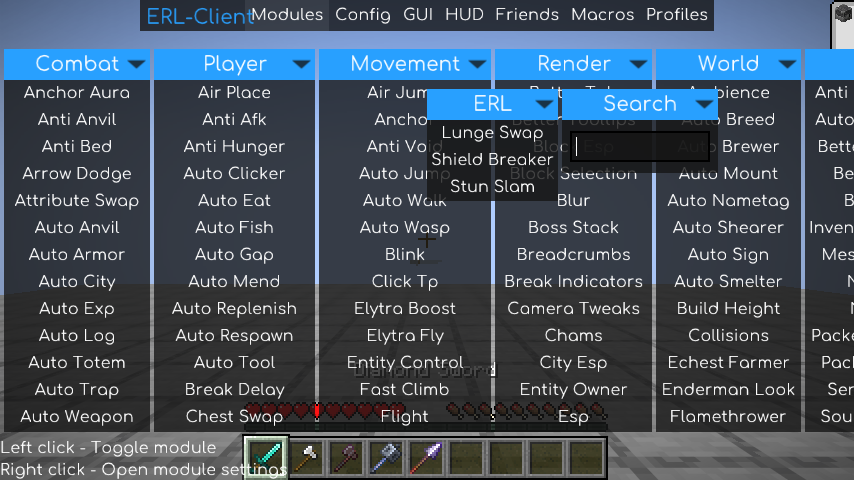
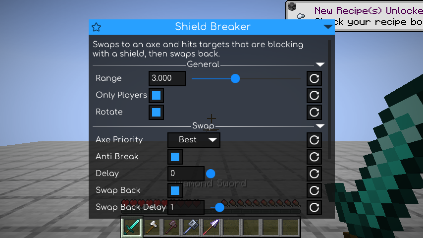
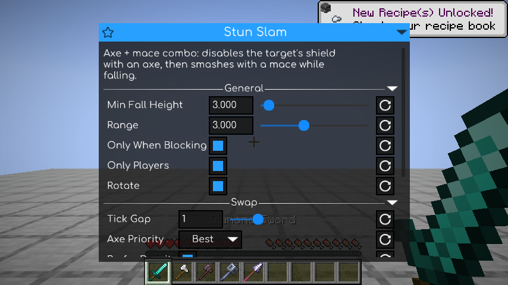
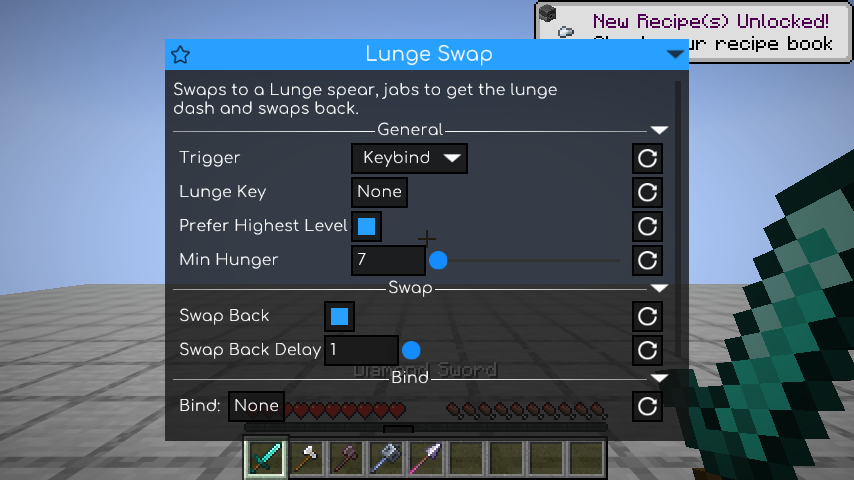

<p align="center">

</p>

<h1 align="center">ERL-Client</h1>
<p align="center">Utility-Client für <b>Minecraft Java 26.3</b> (Fabric) – basiert auf <a href="https://github.com/MeteorDevelopment/meteor-client">Meteor Client</a>.</p>

> **ERL-Client ist ein Fork von [Meteor Client](https://github.com/MeteorDevelopment/meteor-client) von
> [MeteorDevelopment](https://github.com/MeteorDevelopment).** Sämtliche Meteor-Funktionen stammen von deren Team und
> stehen wie dieses Projekt unter der [GPL-3.0](LICENSE). Basis: Meteor `master`, Commit
> [`ec8cdb0`](https://github.com/MeteorDevelopment/meteor-client/commit/ec8cdb088af88582bade7cd3b0dfbe71ccd2285c).
> Bitte melde Fehler in ERL-Client **nicht** bei Meteor.



## Features

- **Alle Meteor-Client-Features**: Module (Combat, Player, Movement, Render, World, Misc), HUD-Editor, Befehle
  (Prefix `.`), Freunde, Makros, Profile, Waypoints, Baritone-Integration, Addon-Unterstützung.
- **Eigene Kategorie „ERL“** mit drei neuen Modulen (siehe unten).
- **Branding**: Fenstertitel `ERL-Client <Version> - Minecraft 26.3`, Click-GUI-Titel, Chat-Prefix `[ERL]`,
  eigene Splash-Texte, Titelbildschirm-Credits (inkl. Hinweis auf Meteor Client), eigenes Icon.
- **Config-Ordner**: `.minecraft/erl-client/`
- **Meteor-Addons** laufen weiter: ERL-Client meldet sich gegenüber Fabric zusätzlich als `meteor-client`.
- Keine Online-Statistik-Pings an meteorclient.com; Discord-Rich-Presence ist standardmäßig aus.

## ERL-Module

Alle drei Module findest du in der Click-GUI (**Rechte Shift**) in der Kategorie **ERL**. Wie jedes Meteor-Modul
lassen sie sich per Mittelklick (oder in den Moduleinstellungen unter *Bind*) auf eine Taste legen.

| Einstellungen | | |
|---|---|---|
|  |  |  |

### ShieldBreaker

Erkennt ein Ziel, das **mit dem Schild in deine Richtung** blockt. ShieldBreaker wechselt dann automatisch auf eine Axt
in der Hotbar, schlägt zu (der Schild ist 5 Sekunden deaktiviert) und wechselt zurück.

| Einstellung | Bedeutung | Standard |
|---|---|---|
| `range` | Reichweite bis zur Hitbox des Ziels | 3 |
| `only-players` | Nur Spieler als Ziel | an |
| `rotate` | Zum Ziel drehen. Aus: nur das Ziel unter dem Fadenkreuz | an |
| `axe-priority` | `Best` (Netherite > Diamant > Eisen > Kupfer > Stein > Gold > Holz), `Worst`, `FirstSlot` | Best |
| `anti-break` | Äxte mit ≤ 10 Haltbarkeit ignorieren | an |
| `delay` | Ticks zwischen Axt-Wechsel und Schlag (0 = gleicher Tick) | 0 |
| `swap-back` / `swap-back-delay` | Zurückwechseln und Ticks bis dahin | an / 1 |

### StunSlam

Kombo aus Axt und Streitkolben: Zuerst deaktiviert ein Axt-Treffer den Schild (Stun), dann folgt sofort mit dem Mace
ein Smash-Angriff aus dem Fall. Pro Fall wird nur eine Kombo ausgeführt.

| Einstellung | Bedeutung | Standard |
|---|---|---|
| `min-fall-height` | Mindest-Fallhöhe in Blöcken (Smash braucht > 1,5) | 3 |
| `range` | Reichweite bis zur Hitbox des Ziels | 3 |
| `only-when-blocking` | Nur auslösen, wenn das Ziel blockt. Aus: ohne Schild direkt Mace-Smash | an |
| `only-players` / `rotate` | wie bei ShieldBreaker | an / an |
| `tick-gap` | Ticks zwischen Axt- und Mace-Treffer (0 = gleicher Tick) | 1 |
| `axe-priority` | Welche Axt | Best |
| `prefer-density` | Bei mehreren Maces den mit höchster Dichte nehmen | an |
| `swap-back` | Danach auf den vorherigen Slot zurückwechseln | an |

### LungeSwap

Wechselt auf einen **Speer mit Lunge**, führt einen Jab aus (Lunge-Dash nach vorn) und wechselt zurück.

| Einstellung | Bedeutung | Standard |
|---|---|---|
| `trigger` | `Keybind` (eigene Taste `lunge-key`) oder `OnAttack` (jeder Linksklick, der keinen Block trifft) | Keybind |
| `lunge-key` | Taste für den Lunge (nur bei `Keybind`) | – |
| `prefer-highest-level` | Höchstes Lunge-Level (weiter) statt niedrigstes (weniger Hunger) | an |
| `min-hunger` | Pausiert unter diesem Hungerwert (7–20) | 7 |
| `swap-back` / `swap-back-delay` | Zurückwechseln und Ticks bis dahin | an / 1 |

## Vanilla-Mechaniken in 26.3 (am Quellcode geprüft)

- **Schild-Deaktivierung** (`Player#blockUsingItem`): Nur **Spieler** verlieren ihren Schild. Das passiert, wenn sie
  einen Nahkampftreffer blocken und die Waffe des Angreifers eine `minecraft:weapon`-Komponente mit
  `disable_blocking_for_seconds > 0` hat (alle Äxte: 5 s). Geblockt wird nur innerhalb von 90° um die Blickrichtung
  und erst 5 Ticks nach dem Hochnehmen des Schilds. Die Module prüfen beides, bevor sie wechseln. Mobs mit Schild
  blocken zwar, ihr Schild wird aber nie deaktiviert.
- **Mace-Smash** (`MaceItem`): ab `fallDistance > 1,5`, nicht beim Elytra-Flug. Der Fallbonus skaliert **nicht** mit
  der Angriffsladung, deshalb kostet der schnelle Wechsel kaum Schaden. Ein komplett geblockter Axt-Treffer setzt beim
  Gegner `lastHurt = 0`, daher trifft der Mace trotz Unverwundbarkeitsfenster mit vollem Schaden.
- **Speer-Jab & Lunge** (`lunge.json`, `PiercingWeapon`): Der Jab (Linksklick) löst Lunge aus. Der Dash beträgt
  0,458 × Stufe, kostet 4 × Stufe Erschöpfung und 1 Haltbarkeit. Er wirkt nur mit **≥ 7 Hunger** (außer im
  Kreativmodus), nicht im Wasser, nicht beim Elytra-Flug und nicht auf Reittieren. Ein Speer braucht **volle
  Angriffsladung**. Der Server prüft beim Jab aber noch die Ladung der vorherigen Waffe. LungeSwap wartet deshalb,
  bis die aktuelle Waffe voll geladen ist, und wechselt dann und jabbt im selben Tick.

> ⚠️ Viele Server verbieten Clients mit Kampf-Automatisierung. Nutze ERL-Client nur dort, wo es erlaubt ist
> (z. B. Singleplayer, eigene Server, Anarchy-Server).

## Installation

1. [Fabric Loader](https://fabricmc.net/use/) **0.20.1 oder neuer** für Minecraft **26.3** installieren.
2. `erl-client-1.0.0-mc26.3.jar` in den `mods`-Ordner legen (`.minecraft/mods`).
3. Die Fabric API ist **nicht** nötig (die benötigten Module sind eingebettet), stört aber auch nicht.
4. **Nicht** zusammen mit Meteor Client installieren – ERL-Client *ist* Meteor Client plus Extras.
5. Minecraft mit dem Fabric-Profil starten, Click-GUI mit **Rechte Shift** öffnen.

## Selbst bauen

Voraussetzung: **JDK 25**.

```bash
cd erl-client
./gradlew build
# Ergebnis: build/libs/erl-client-1.0.0-mc26.3.jar
```

Entwicklungs-Client starten:

```bash
./gradlew runClient
```

Automatischer Client-Test (erstellt eine Welt, prüft Branding, Click-GUI, Keybinds und alle drei ERL-Module gegen einen
Schild blockenden Test-Gegner, macht Screenshots unter `run/screenshots/`). Ohne Bildschirm mit `xvfb-run -a` davor:

```bash
./gradlew runClientGameTest
```

### Toolchain

| | Version |
|---|---|
| Minecraft | 26.3 (seit 26.1 nicht mehr obfuskiert, offizielle Mojang-Namen) |
| Fabric Loader | 0.20.1 |
| Fabric API | 0.167.0+26.3 (eingebettet: `fabric-api-base`, `fabric-resource-loader-v1`) |
| Loom | 1.19.4 |
| Gradle | 9.9.2 |
| Java | 25 |

Die Versionen stehen wie bei Meteor in `gradle/libs.versions.toml`, die Mod-Version in `gradle.properties`.

## Projektstruktur

- `src/main/java/meteordevelopment/meteorclient/` – Meteor-Kern. Das Package wurde bewusst nicht umbenannt, damit
  sich Upstream-Updates einfach mergen lassen und Addons kompatibel bleiben.
- `src/main/java/de/erl/client/` – ERL-eigener Code: `ErlClient` (Kategorie, Registrierung), `modules/`
  (ShieldBreaker, StunSlam, LungeSwap) und `utils/ErlCombatUtils`.
- `src/gametest/` – Fabric-Client-Gametest.

## Credits

- **[Meteor Client](https://github.com/MeteorDevelopment/meteor-client)** von **MeteorDevelopment**
  (MineGame159, squidoodly, seasnail und alle Mitwirkenden) – die gesamte Basis dieses Clients.
- [Cabaletta](https://github.com/cabaletta) und [WagYourTail](https://github.com/wagyourtail) für [Baritone](https://github.com/cabaletta/baritone).
- Das [Fabric-Team](https://github.com/FabricMC) für [Fabric](https://github.com/FabricMC/fabric-loader).

## Lizenz

ERL-Client steht wie Meteor Client unter der
[GNU General Public License v3.0](https://www.gnu.org/licenses/gpl-3.0.de.html) (siehe [LICENSE](LICENSE)).
Wer Code daraus verwendet, muss den Quellcode offenlegen, die Herkunft deutlich angeben und dieselbe Lizenz verwenden.
