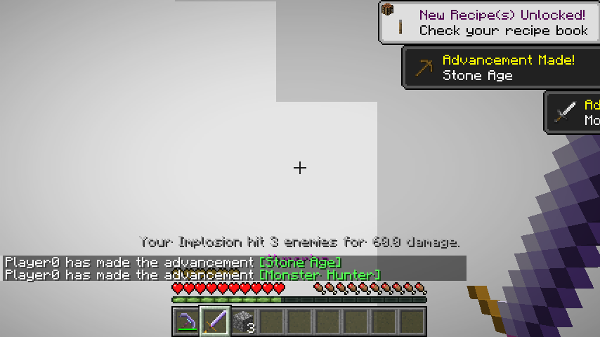
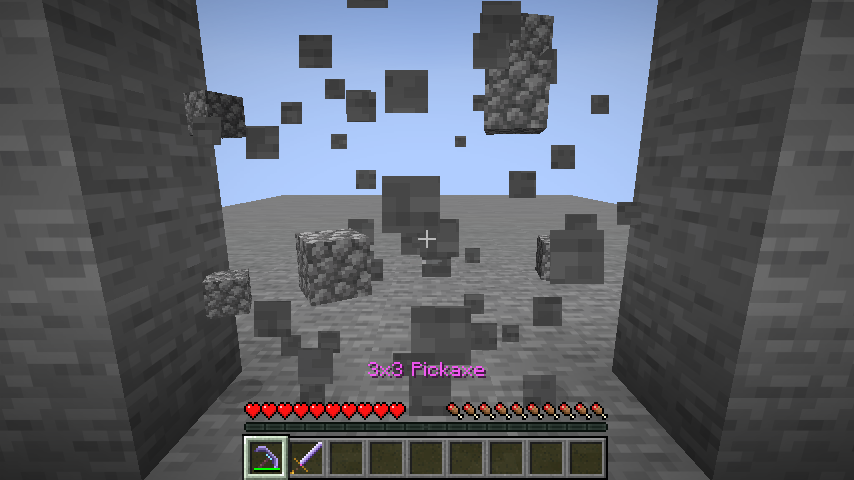

# Erleichterungen Werkzeuge – Fabric-Mod für Minecraft 26.3

Eigenständige Mod (getrennt von der Client-Mod *Erleichterungen*) mit zwei neuen Items.

**Download:** https://github.com/paulpuder30-cloud/Minecraft-erleichterungen-/raw/claude/sharp-ramanujan-8l5uv8/download/erleichterungen-werkzeuge-1.0.0.jar

> Die Mod fügt neue Items hinzu und muss deshalb **auf dem Server** (bzw. im Einzelspieler) installiert sein –
> und bei Mitspielern auch im Client. Auf fremden Servern ohne die Mod funktioniert sie nicht.

## Hyperion

Netherit-Schwert (13 Angriffsschaden, feuerfest) mit der Fähigkeit **Wither Impact** – **Rechtsklick**, beliebig oft
hintereinander:

1. **Teleport** 10 Blöcke in Blickrichtung (auch nach oben/unten). Vor Wänden stoppt der Teleport, Fallschaden wird zurückgesetzt.
2. **Implosion** am Landepunkt: 50 magischer Schaden an allen Gegnern (Monstern) im Umkreis von 10 Blöcken.
   Explosions-Effekt und -Sound, aber keine Blockschäden. Die Aktionsleiste zeigt
   „Implosion traf X Gegner für Y Schaden“.
3. **Wither-Schild**: 6 Absorptionsherzen und 10 % weniger Schaden für 5 Sekunden. Danach wird die Hälfte der übrigen
   Absorption in Heilung umgewandelt. Der Schild kann erst nach Ablauf erneut ausgelöst werden.

Unterschiede zur Skyblock-Vorlage: Vanilla hat kein Mana und keine Skyblock-Werte (Intelligenz, Ferocity …).
Deshalb kostet die Fähigkeit nichts, und der Schaden ist fest (50) statt mit Intelligenz zu skalieren.

Rezept: Netheritschwert in der Mitte, Netherstern oben, Netherit-Barren links, rechts und unten.



## 3x3-Spitzhacke

Netherit-Spitzhacke, die eine **senkrechte 3x3-Fläche quer zur Blickrichtung** abbaut
(passt zum *Ausheben*-Modul der Erleichterungen-Mod).
- **Schleichen** baut nur den einen Block ab.
- Nachbarblöcke werden nur abgebaut, wenn die Spitzhacke sie normal abbauen kann und sie nicht viel härter sind
  als der angeschlagene Block (kein Obsidian aus Versehen).
- Drops, Verzauberungen (Glück, Behutsamkeit) und Haltbarkeit funktionieren wie beim normalen Abbauen.

Rezept: Netherit-Spitzhacke in der Mitte, Netherit-Barren oben, links, rechts und unten.



Beide Items gibt es auch im Kreativmodus (Kampf bzw. Werkzeuge) und per
`/give @s werkzeuge:hyperion` bzw. `/give @s werkzeuge:pickaxe_3x3`.

## Bauen und Testen

```bash
cd werkzeuge-mod
./gradlew build               # benötigt Java 25 → build/libs/erleichterungen-werkzeuge-1.0.0.jar
./gradlew runClientGameTest   # Testwelt: 3x3 baut genau 9 Blöcke ab; Hyperion teleportiert 10 Blöcke,
                              # tötet Zombies im Umkreis, verschont weiter entfernte, gibt Schild, stoppt vor Wänden
```
